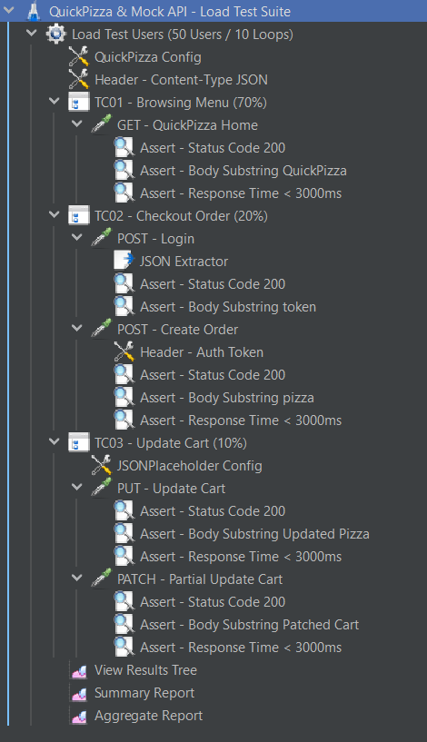
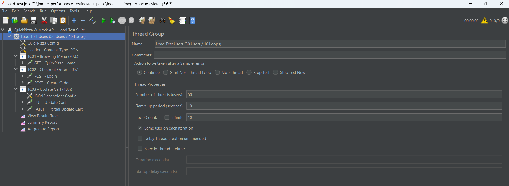
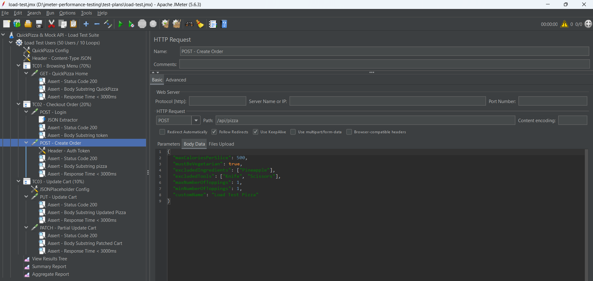
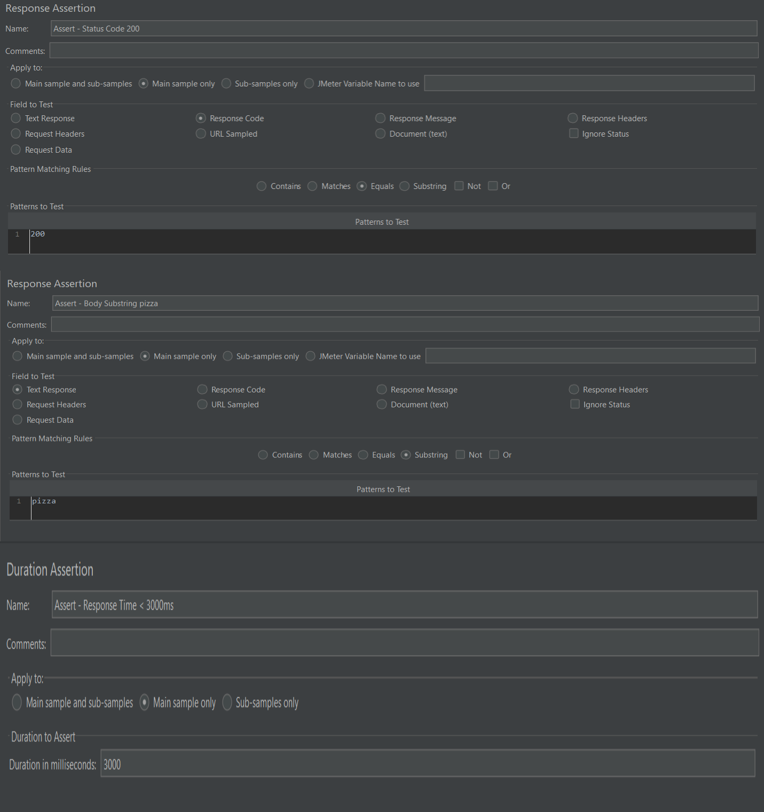
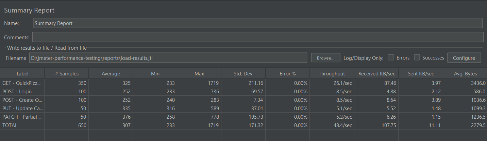
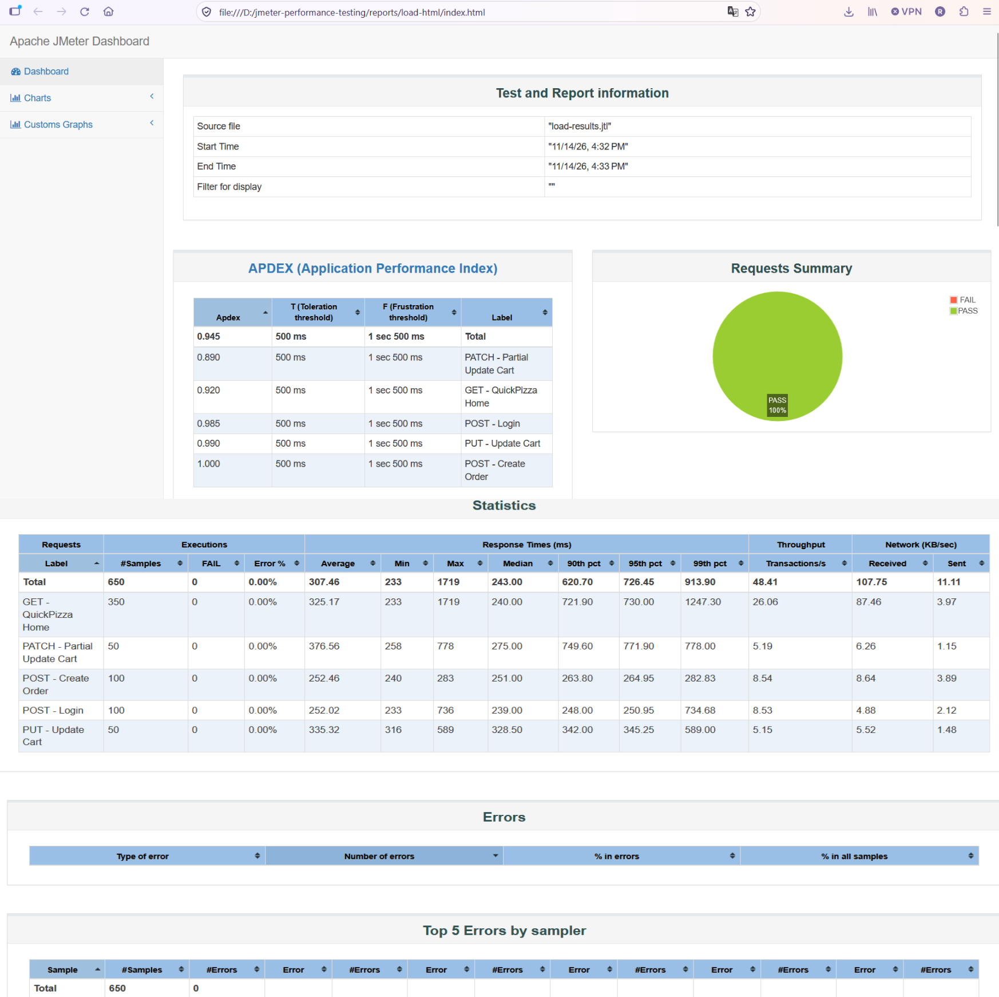

# JMeter Performance Testing: QuickPizza API


A performance testing suite built with **Apache JMeter** for the public [QuickPizza](https://quickpizza.grafana.com) demo API. It contains five test plans (smoke, load, stress, spike, and data-driven) that mix GET, POST, PUT, PATCH, and DELETE requests, reuse an auth token between requests, and check every response with assertions. Results are written to `.jtl` files and HTML dashboards, and a GitHub Actions workflow runs the smoke and data-driven plans on every push.

---

## Key features

- **Five test plans:** smoke, load, stress, spike, and data-driven.
- **Mixed HTTP methods:** GET, POST, PUT, PATCH, and DELETE.
- **Weighted workloads:** Throughput Controllers split each user's iterations into browsing, checkout, and cart-update flows (for example 70% / 20% / 10% in the load test).
- **Token correlation:** a JSON Extractor reads the token from the login response, and the following requests send it in the `Authorization` header.
- **Data-driven testing:** a CSV Data Set Config feeds ten pizza orders into the requests.
- **Spike simulation:** a Synchronizing Timer holds 100 users and releases them at the same moment.
- **Assertions on every key request:** HTTP status code, response body text, and a maximum response time (Duration Assertion).
- **Non-GUI execution:** a batch script runs all five plans and generates an HTML dashboard for each one.
- **CI:** GitHub Actions runs the smoke and data-driven plans and uploads the reports as an artifact.

---

## Targets

| Service | Used for | Requests |
|---|---|---|
| [QuickPizza](https://quickpizza.grafana.com) (Grafana's public demo app) | Main target | `GET /`, `POST /api/users/token/login`, `POST /api/pizza` |
| [JSONPlaceholder](https://jsonplaceholder.typicode.com) (public fake REST API) | Update and delete methods | `PUT`, `PATCH`, `DELETE` on `/posts/{id}` |

Both are public demo services that I do not own, so I kept the load modest. JSONPlaceholder is a fake API: write requests return a realistic response but nothing is saved.

---

## Test plans

| Plan | Users | Ramp-up | Loops | Workload | Max response time (assertion) |
|---|:---:|:---:|:---:|---|:---:|
| **Smoke** (`smoke-test.jmx`) | 1 + 1 | 1 s | 1 | Two thread groups. QuickPizza: `GET /`, login, create order. JSONPlaceholder: `PUT`, `PATCH`, `DELETE` (6 requests in total) | 2,000 ms |
| **Load** (`load-test.jmx`) | 50 | 10 s | 10 | 70% browse (`GET /`), 20% checkout (login + create order), 10% cart update (`PUT` + `PATCH`) | 3,000 ms |
| **Stress** (`stress-test.jmx`) | 150 | 60 s | 20 | 50% browse, 40% checkout, 10% cart update (`PUT`) | 5,000 ms |
| **Spike** (`spike-test.jmx`) | 100 | 5 s | 10 | Synchronizing Timer (group of 100, 5 s timeout), 70% browse, 30% checkout | 6,000 ms |
| **Data-driven** (`data-driven-test.jmx`) | 10 | 5 s | 2 | `GET /?menu={search_tag}`, login, create custom order, and `PUT` update note, all with values from the CSV | 3,000 ms |

**Assertions:** each key request checks that the status code equals `200` and that the body contains an expected text (for example `QuickPizza`, `token`, or `pizza`). Most requests also have a Duration Assertion with the limit above.

**Test data** (`data/pizza-orders.csv`): ten rows with `post_id`, `search_tag`, `custom_name`, `max_calories`, `is_vegetarian`, `min_toppings`, `max_toppings`, and `update_note`. The header row is skipped and the file is recycled when the rows run out.

---

## Results

Numbers come from the HTML dashboards generated by the non-GUI runs on my laptop (Windows, public internet).

| Test | Samples | Errors | Error % | Avg | p95 | Max | Throughput |
|---|---:|---:|---:|---:|---:|---:|---:|
| Smoke | 6 | 0 | 0.00% | 535 ms | 1,181 ms | 1,181 ms | 3.43 req/s |
| Load | 650 | 0 | 0.00% | 307 ms | 726 ms | 1,719 ms | 48.41 req/s |
| Stress | 4,200 | 19 | 0.45% | 343 ms | 333 ms | 22,023 ms | 47.67 req/s |
| Spike | 1,300 | 0 | 0.00% | 485 ms | 1,925 ms | 4,004 ms | 95.21 req/s |
| Data-driven | 80 | 2 | 2.50% | 839 ms | 995 ms | 21,774 ms | 2.97 req/s |

The smoke test has only 6 samples, so its percentiles are not meaningful.

### What the results show

1. **Load test:** 650 requests, no errors, and every request finished well under the 3-second limit (p95 726 ms).
2. **Spike test:** the synchronized burst of 100 users produced no errors, but latency rose. For `GET /`, p95 was 1,960 ms in the spike test compared with 730 ms in the load test. The slowest request took 4,004 ms, still under the 6-second limit.
3. **Stress test:** 19 of 4,200 requests failed. All 19 were `GET /` requests that returned HTTP 200 but took between 15.7 s and 22 s, which breaks the 5-second Duration Assertion (1.27% of the `GET /` requests). Login, create order, and update requests had no failures.
4. **Data-driven test:** 2 of 80 requests failed, both `GET /?menu=...` requests that took 15.8 s and 21.8 s, over the 3-second limit.

The slow requests in the stress and data-driven runs show a similar pattern (about 15.7 s and 21.7 s). I did not investigate the cause, so I cannot say whether it comes from my network, my machine, or the demo service.

---

## Getting started

### Prerequisites

- Java 17 (Temurin or equivalent)
- [Apache JMeter 5.6.3](https://jmeter.apache.org/download_jmeter.cgi), with the `bin` folder added to your `PATH`

Check the installation:

```bash
java -version
jmeter -v
```

### Run one test plan (non-GUI)

Run from the repository root. The HTML report folder must not exist yet, otherwise JMeter refuses to overwrite it.

```bash
mkdir -p reports
jmeter -n -t test-plans/smoke-test.jmx -l reports/smoke-results.jtl -e -o reports/smoke-html
```

| Flag | Meaning |
|---|---|
| `-n` | Non-GUI mode |
| `-t` | Test plan file |
| `-l` | Results file (`.jtl`) |
| `-e -o` | Generate the HTML dashboard in the given folder |

### Run all five plans (Windows)

```bat
run-all-tests.bat
```

The script deletes the previous results, runs smoke, load, stress, spike, and data-driven in that order, and creates `reports/<name>-results.jtl` and `reports/<name>-html/` for each. Open `reports/<name>-html/index.html` in a browser to see the dashboard.

### Open a plan in the GUI

```bash
jmeter -t test-plans/load-test.jmx
```

Use the GUI only to build and debug a plan. Run stress and spike in non-GUI mode, because the **View Results Tree** listener keeps every sample in memory.

---

## Continuous integration

[`.github/workflows/jmeter-ci.yml`](.github/workflows/jmeter-ci.yml) runs on every push and pull request to `main` or `master`:

1. Check out the repository
2. Set up Java 17 (Temurin)
3. Download Apache JMeter 5.6.3
4. Run the **smoke** and **data-driven** plans in non-GUI mode with HTML reports
5. Upload the `reports/` folder as the `jmeter-performance-reports` artifact

The plans call live public services, so a run can occasionally be slow or fail because of the network. The workflow does not fail the job when a sample fails an assertion: the failure appears in the report, but the pipeline still finishes.

---

## Screenshots

All screenshots show the load test plan.

| | |
|---|---|
|  |  |
| Test plan structure with the three weighted flows | Thread group: 50 users, 10 s ramp-up, 10 loops |
|  |  |
| `POST /api/pizza` request with a JSON body and auth header | Status code, body, and duration assertions |
|  |  |
| Summary Report: 650 samples, 0% errors | HTML dashboard generated by the non-GUI run |

---

## Repository structure

```text
jmeter-performance-testing/
├── .github/
│   └── workflows/
│       └── jmeter-ci.yml        # GitHub Actions: smoke and data-driven plans
├── data/
│   └── pizza-orders.csv         # Test data for the data-driven plan
├── test-plans/
│   ├── smoke-test.jmx
│   ├── load-test.jmx
│   ├── stress-test.jmx
│   ├── spike-test.jmx
│   └── data-driven-test.jmx
├── screenshots/                 # JMeter GUI and dashboard captures
├── run-all-tests.bat            # Runs all five plans and creates the HTML reports
├── .gitignore
└── README.md
```

`reports/` (the `.jtl` result files and the HTML dashboards) is created when you run the tests and is excluded by `.gitignore`, as are `*.log` files.

---

## Notes and limitations

- **Public demo services.** The targets are not mine, and the numbers include my network latency, so they show the behavior I measured and not the capacity of the servers.
- **No think time.** Users send requests back to back, so the traffic is more aggressive than a real user session.
- **Loop-based load.** Each plan runs a fixed number of loops instead of a fixed duration, so runs are hard to compare when the machine or network changes.
- **Spike profile.** The spike plan releases 100 users at once with a Synchronizing Timer. It does not model a baseline, then a burst, then a recovery.
- **Duration Assertion as pass/fail.** A slow response with HTTP 200 counts as a failed sample, which is why a few slow requests appear as errors in the stress and data-driven runs.
- **No gate in CI.** The workflow does not check error rate or response time thresholds.
- **Demo credentials.** The login used in the plans is the public demo account of QuickPizza.

## Next improvements

- Add think-time timers and make users, ramp-up, and loops configurable with `-J` properties.
- Fail the CI job when the error rate or p95 crosses a threshold.
- Switch the load, stress, and spike plans to duration-based runs.
- Investigate the slow outliers by running from a different network.
